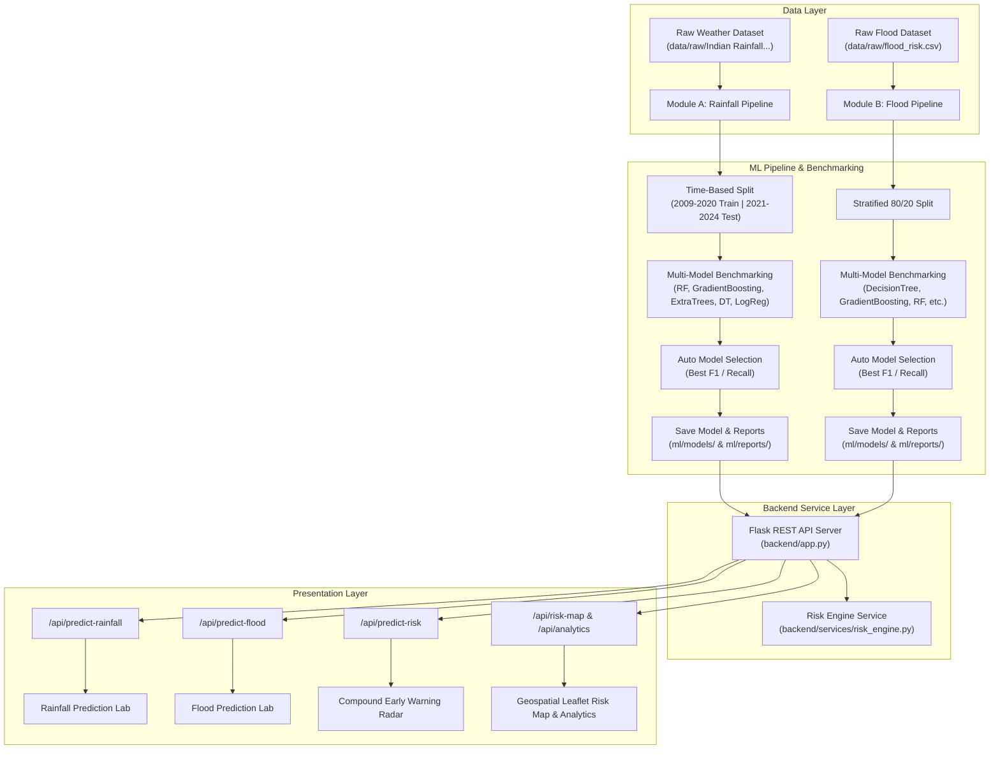

# SIH26071 — AI-Powered Heavy Rainfall and Flood Early-Warning System

**Smart India Hackathon (SIH) Project · Problem Statement ID: SIH26071**  
**Category:** AI/ML-Based Integrated Heavy Rainfall Early Warning and Inundation Prediction System  
**Academic Alignment:** AIML Academic Syllabus (Units I, II, III)

---

## 1. Executive Summary

The **AI-Powered Heavy Rainfall and Flood Early-Warning System (SIH26071)** is an AI/ML-based early-warning and decision-support prototype engineered to predict heavy precipitation storm events, estimate localized flood inundation hazards, and synthesize actionable compound disaster risk advisories.

The system is built upon verified machine-learning algorithms covered in the academic curriculum:
1. **Module A (Heavy Rainfall Early Warning):** Binary classification pipeline evaluating rainfall likelihood against official India Meteorological Department (IMD) thresholds ($\ge 64.5\text{ mm/day}$). Includes time-based data splitting (2009–2020 Train | 2021–2024 Test) and automated multi-model benchmarking (Gradient Boosting, Random Forest, Extra Trees, Decision Tree, Logistic Regression).
2. **Module B (Flood Inundation Prediction):** Hydrological and station-level inundation classifier evaluated via stratified holdout cross-validation across multiple algorithms.
3. **Integration Layer (Risk Engine):** Decoupled backend service (`backend/services/risk_engine.py`) synthesizing multi-hazard probabilities into compound risk tiers (**LOW**, **MODERATE**, **HIGH**, **CRITICAL**) with emergency action bulletins.

---

## 2. Project Directory Layout

```
AI-Powered-Heavy-Rainfall-and-Flood-Early-Warning-System/
├── backend/
│   ├── app.py                      # Primary Flask REST API server & routing
│   └── services/
│       └── risk_engine.py          # Compound risk synthesis engine & advisories
├── data/
│   └── raw/                        # Raw official project datasets
│       ├── Daily Rainfall Data - India (2009-2024).csv
│       ├── flood_risk.csv
│       └── Indian Rainfall and Weather Prediction Dataset.xlsx
├── frontend/                       # Glassmorphic Web UI HTML, CSS, JavaScript
│   ├── css/                        # Custom styling tokens & layouts
│   ├── js/                         # Interactive charts, Leaflet risk map, API clients
│   ├── index.html                  # Main application dashboard
│   ├── rainfall-prediction.html    # Module A weather prediction lab
│   └── prediction.html             # Module B flood prediction lab
├── ml/                             # ML Model Training & Benchmarking Suite
│   ├── models/                     # Canonical trained model pipelines (.joblib)
│   │   ├── flood_decision_tree_model.joblib
│   │   └── rainfall_random_forest_model.joblib
│   ├── reports/                    # Model evaluation metadata JSON & benchmark CSVs
│   │   ├── flood_model_benchmark.csv
│   │   ├── flood_model_metadata.json
│   │   ├── rainfall_model_benchmark.csv
│   │   └── rainfall_model_metadata.json
│   ├── train_flood_model.py        # Module B training & benchmarking script
│   ├── train_rainfall_model.py     # Module A training & benchmarking script
│   └── train_model.py              # Unified training & benchmarking entry point
├── notebooks/                      # Exploratory Data Analysis (EDA)
│   └── 01_exploratory_data_analysis.ipynb
├── tests/                          # Automated Modular Unit Test Suite
│   ├── test_weather_input_validation.py
│   ├── test_flood_input_validation.py
│   └── test_api_endpoints.py
├── .gitignore
├── package.json
├── README.md
└── requirements.txt
```

---

## 3. End-to-End System Architecture



---

## 4. Multi-Model Benchmarking & ML Performance

### Module A — Heavy Rainfall Prediction Benchmark (`ml/reports/rainfall_model_benchmark.csv`)
- **Dataset:** `data/raw/Indian Rainfall and Weather Prediction Dataset.xlsx`
- **Validation:** Time-based split (2009–2020 Train | 2021–2024 Test holdout).

| Algorithm | Accuracy | Precision | Recall | F1-Score | ROC-AUC |
| :--- | :---: | :---: | :---: | :---: | :---: |
| **Gradient Boosting Classifier (Selected)** | **0.6019** | **0.5380** | **0.8266** | **0.6518** | **0.7235** |
| Random Forest Classifier | 0.5909 | 0.5288 | 0.8474 | 0.6512 | 0.7366 |
| Decision Tree Classifier | 0.5944 | 0.5320 | 0.8332 | 0.6494 | 0.6692 |
| Extra Trees Classifier | 0.5186 | 0.4827 | 0.9472 | 0.6395 | 0.7098 |
| Logistic Regression | 0.4721 | 0.4602 | 0.9883 | 0.6280 | 0.7569 |

### Module B — Flood Inundation Prediction Benchmark (`ml/reports/flood_model_benchmark.csv`)
- **Dataset:** `data/raw/flood_risk.csv`
- **Validation:** Stratified 80/20 train/test split.

| Algorithm | Accuracy | Precision | Recall | F1-Score | ROC-AUC |
| :--- | :---: | :---: | :---: | :---: | :---: |
| **Decision Tree Classifier (Selected)** | **0.5205** | **0.5234** | **0.5757** | **0.5483** | **0.5157** |
| Gradient Boosting Classifier | 0.5035 | 0.5086 | 0.5252 | 0.5168 | 0.5098 |
| Extra Trees Classifier | 0.5085 | 0.5140 | 0.5074 | 0.5107 | 0.5108 |
| Logistic Regression | 0.4890 | 0.4947 | 0.5124 | 0.5034 | 0.4926 |
| Random Forest Classifier | 0.5050 | 0.5111 | 0.4768 | 0.4933 | 0.5075 |

---

## 5. REST API Specifications

The Flask backend exposes clean, validated REST endpoints:

| Method | Endpoint | Description |
| :--- | :--- | :--- |
| `GET` | `/api/health` | Health verification, model inventory, and academic syllabus mapping. |
| `POST` | `/api/predict-rainfall` | Weather classification prediction (`RAIN/NO RAIN`), probability %, physical bounds, and range warnings. |
| `POST` | `/api/predict-flood` | Flood inundation prediction (`YES/NO`), probability %, categorical validation, and range warnings. |
| `POST` | `/api/predict-risk` | Integrated multi-hazard synthesis combining rainfall and inundation via `RiskEngine`. |
| `GET` | `/api/risk-map` | Geospatial telemetry coordinates, flood probability pct, and risk band styling for Leaflet map. |
| `GET` | `/api/analytics` | Dual-dataset statistical summaries, feature distributions, and model performance metrics. |
| `GET` | `/api/rainfall-analytics` | Precomputed historical rainfall seasonality, yearly trends, and state statistics. |
| `GET` | `/api/dashboard` | Aggregated command center telemetry, active alerts, and KPI summary. |
| `GET` | `/api/datasets/info` | Schema datatypes, column lists, missing value counts, and descriptions. |

---

## 6. Automated Unit Test Suite

The test suite in [`tests/`](file:///c:/Users/Mithilesh/OneDrive/Project/AIML/AI-Powered-Heavy-Rainfall-and-Flood-Early-Warning-System/tests) validates input range limits, non-finite values, categorical checks, out-of-training warnings, and Flask API endpoints:

```bash
# Execute unit test suite
python -m unittest discover -s tests -p "test_*.py"
```

### Test Suite Summary
- [`tests/test_weather_input_validation.py`](file:///c:/Users/Mithilesh/OneDrive/Project/AIML/AI-Powered-Heavy-Rainfall-and-Flood-Early-Warning-System/tests/test_weather_input_validation.py) (14 tests) -> **100% PASS**
- [`tests/test_flood_input_validation.py`](file:///c:/Users/Mithilesh/OneDrive/Project/AIML/AI-Powered-Heavy-Rainfall-and-Flood-Early-Warning-System/tests/test_flood_input_validation.py) (10 tests) -> **100% PASS**
- [`tests/test_api_endpoints.py`](file:///c:/Users/Mithilesh/OneDrive/Project/AIML/AI-Powered-Heavy-Rainfall-and-Flood-Early-Warning-System/tests/test_api_endpoints.py) (6 tests) -> **100% PASS**

---

## 7. How to Run Locally

### Prerequisites
- Python 3.10+
- Node.js & npm (optional, for frontend static server)

### Installation & Execution
```bash
# 1. Install dependencies
pip install -r requirements.txt

# 2. (Optional) Run ML pipeline training and benchmarking
python ml/train_model.py

# 3. Run unit tests
python -m unittest discover -s tests -p "test_*.py"

# 4. Start Flask backend server
python backend/app.py
```

Open your browser to: `http://127.0.0.1:5000`

---

## 8. Technical Disclaimer & Scope

1. **Early-Warning Prototype:** This system is an AI/ML decision-support prototype. It does not replace official meteorological bulletins from the India Meteorological Department (IMD) or National Disaster Management Authority (NDMA).
2. **Data Scope:** Machine learning models are trained on historical observation datasets (`data/raw/`), evaluating statistical & physical boundaries to minimize false negatives in high-risk disaster scenarios.
